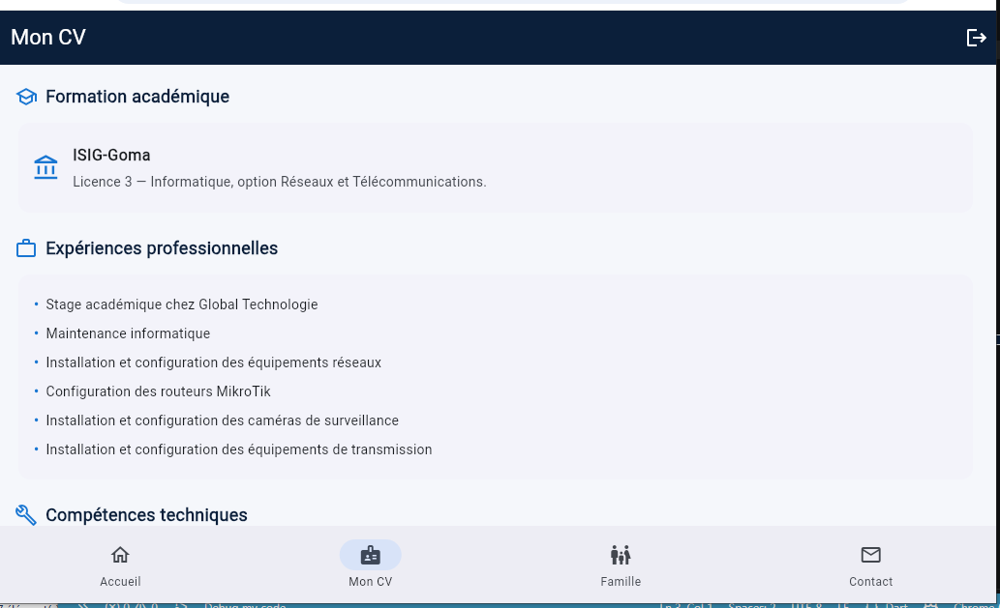

# cv_flutter_jean

A new Flutter project.

## Getting started

## Captures d'ecran

### 1. Page de connexion


### 2. Page d'acceuil


# cv_flutter_jean

Application Flutter : CV, famille et contact de **Jean Awuziku**.
Depuis le TP2, la connexion et les membres de famille passent par une
**API REST PHP + MySQL** (https://github.com/espoirbaraka/api-test).

## TP2 : Flutter + API REST

### Vidéo de démonstration


La vidéo montre : connexion refusée (mauvais mot de passe), connexion réussie,
ajout d'un membre, redémarrage de l'application (les données restent, car elles
sont en base), modification, puis suppression avec confirmation.

### Prérequis
1. Placer l'API dans `C:\xampp\htdocs\api-test` (XAMPP) ou `C:\wamp64\www\api-test` (WampServer), puis démarrer **Apache** et **MySQL**.
2. Créer la base `api` dans phpMyAdmin et importer `api.sql`.
3. Vérifier `.env` (`DB_HOST=127.0.0.1`, `DB_PORT=3306`, `DB_DATABASE=api`, `DB_USERNAME=root`, mot de passe vide).
4. Tester : http://localhost/api-test/public/famille-membres doit renvoyer `{"success":true,"data":[]}`.
5. Créer un compte (`POST /accounts/register` avec `email` et `password`), par exemple avec `curl.exe`.

### Lancer l'application
```bash
flutter pub get
flutter run -d windows      # ou : flutter run -d chrome --release
```
Adresse de l'API (`lib/core/config/api_config.dart`) : `http://localhost/api-test/public`
(`10.0.2.2` sur émulateur Android). Pour un téléphone physique :
`flutter run --dart-define=API_BASE_URL=http://IP_DU_PC/api-test/public`.
En mode Web, on peut aussi servir l'application depuis le même serveur que l'API
(pas de blocage CORS) : `flutter build web --release --base-href /cvapp/`, puis copier
`build/web` dans `www/cvapp` et ouvrir http://localhost/cvapp/.

### Fonctionnalités
- Connexion réelle : e-mail + mot de passe vérifiés via `POST /accounts/login`.
- Liste des membres lue depuis `GET /famille-membres` (rechargée après chaque opération).
- Ajout (`POST`), modification (`PUT /famille-membres/{id}`) et suppression avec confirmation (`DELETE`).
- Photo facultative d'un membre (champ `image`, 2 Mo max) : envoi en multipart ;
  affichage via `image_url`.
- Bouton « Créer un compte » sur la page de connexion (`POST /accounts/register`).
- Gestion des erreurs : serveur injoignable, délai dépassé, réponse invalide, message de l'API et détail des champs invalides (`errors`).

> Le README de l'API indique que les routes CRUD n'exigent pas de jeton côté
> serveur : la connexion vérifie les identifiants, mais ne protège pas ces routes.

## Lancer le projet

```bash
flutter pub get
flutter run -d chrome        # ou un téléphone / émulateur
flutter test
```

## Structure du code

```
lib/
├── main.dart                 point d'entrée
├── app.dart                  MaterialApp + thème
├── core/
│   ├── constants/            app_assets.dart  (chemins des images)
│   ├── theme/                app_colors.dart, app_theme.dart
│   ├── utils/                responsive.dart, launcher.dart
│   └── widgets/              composants réutilisables
├── data/                     CONTENU modifiable
│   ├── profile_data.dart     nom, téléphone, e-mail, adresse
│   ├── cv_data.dart          formation, expérience, compétences…
├── models/                   FamilyMember (API), CvEntry
├── services/                 api_service.dart  (appels HTTP vers l'API)
└── features/
    ├── auth/                 connexion (via l'API)
    ├── shell/                barre du haut + navigation
    ├── home/                 accueil
    ├── cv/                   CV à l'écran + export PDF
    ├── family/               liste + ajout / modification / suppression
    └── contact/              coordonnées

assets/images/
├── profile/accueil.jpg       photo d'accueil et du CV
└── family/famille_1..4.jpg   photos de l'onglet Famille
```

## Remplacer la photo d'accueil

Remplacez `assets/images/profile/accueil.jpg` (même nom) ou changez le chemin
dans `lib/core/constants/app_assets.dart`.

## Mettre à jour le CV

Modifiez `lib/data/cv_data.dart` et `lib/data/profile_data.dart` : l'écran
et le PDF (bouton « Imprimer / PDF ») se mettent à jour ensemble.

## Captures d'écran

### 1. Page de connexion


### 2. Page d'accueil


### 3. Page CV



### 4. Page famille


### 5. Page de contact


### 6. Capture supplémentaire

### 3. Page CV


### 4. Page famille


### 5. Page de contact


### 6. Capture supplémentaire

This project is a starting point for a Flutter application.

A few resources to get you started if this is your first Flutter project:

- [Learn Flutter](https://docs.flutter.dev/get-started/learn-flutter)
- [Write your first Flutter app](https://docs.flutter.dev/get-started/codelab)
- [Flutter learning resources](https://docs.flutter.dev/reference/learning-resources)

For help getting started with Flutter development, view the
[online documentation](https://docs.flutter.dev/), which offers tutorials,
samples, guidance on mobile development, and a full API reference.
