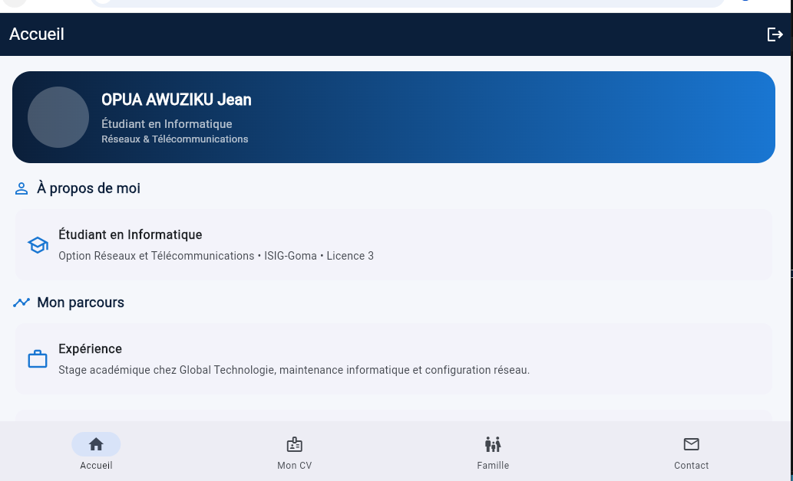
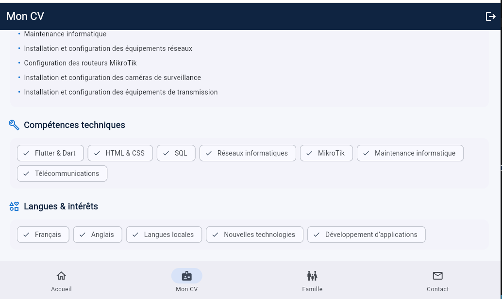
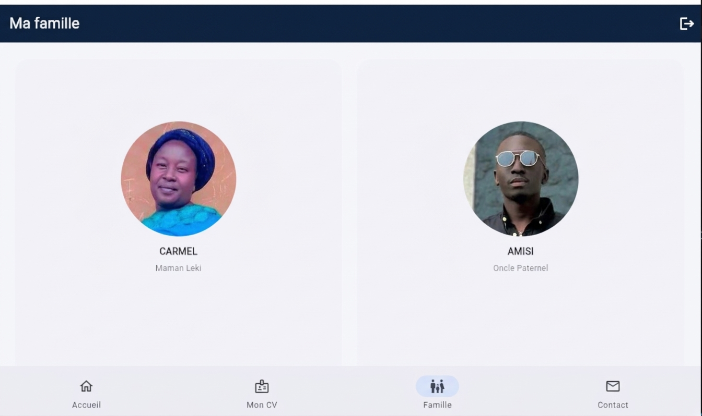
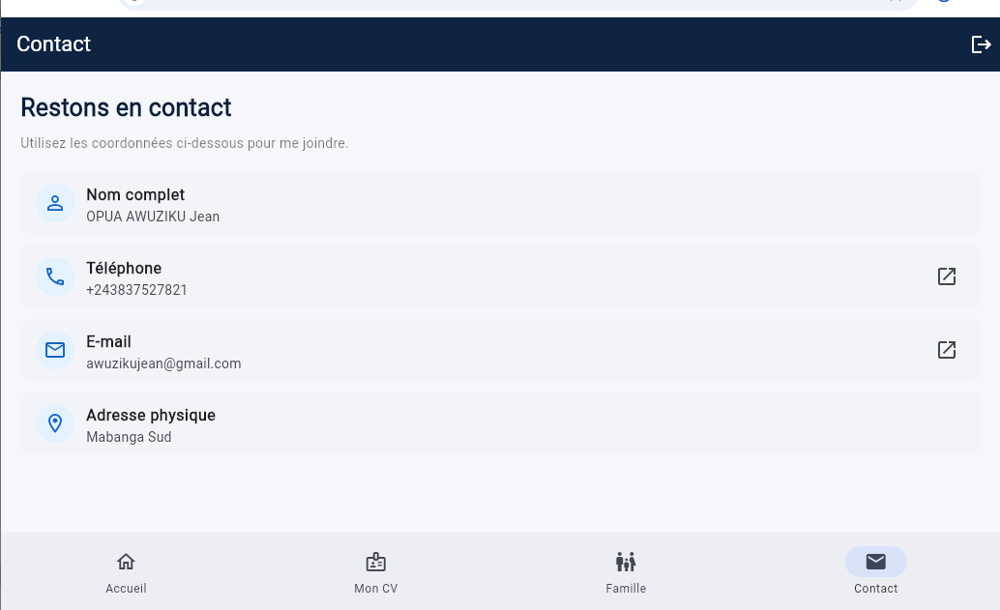

## TP2 : Flutter + API REST

### Vidéo de démonstration

**[Voir la capture vidéo de démonstration](COLLER_ICI_LE_LIEN_DE_LA_VIDEO).**

La vidéo montre : connexion refusée (mauvais mot de passe), connexion réussie,
ajout d'un membre, redémarrage de l'application (les données restent, car elles
sont en base), modification, puis suppression avec confirmation.

## Captures d'écran

### 1. Page de connexion

### 2. Page d'accueil

### 3. Page CV

### 4. Page famille

### 5. Page de contact

### 6. Capture supplémentaire

