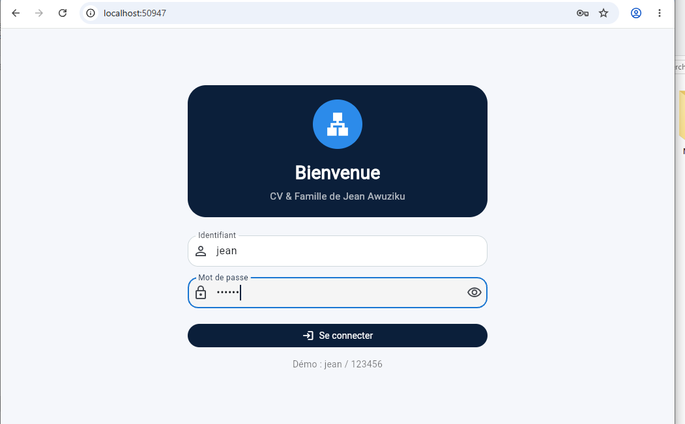
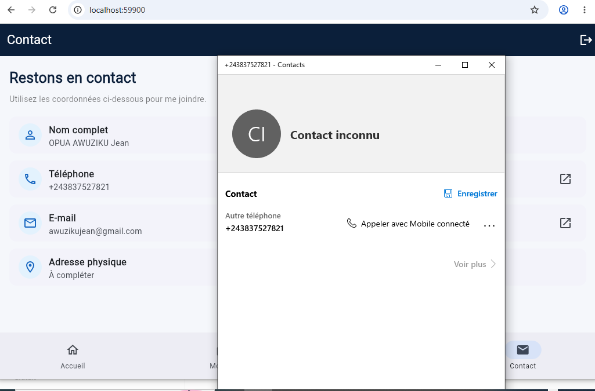

# cv_flutter_jean

A new Flutter project.

## Getting started

## TP2 : Flutter + API REST

### Vidéo de démonstration
**[Voir la capture vidéo de démonstration](https://drive.google.com/file/d/1mUJnVj0lChIrr16IF9pQh8R7Q5ydintL/view?usp=sharing).**

La vidéo montre : connexion refusée (mauvais mot de passe), connexion réussie,
ajout d'un membre, redémarrage de l'application (les données restent, car elles
sont en base), modification, puis suppression avec confirmation.

## Captures d'écran

### 1. Page de connexion

### 2. Page d'accueil

### 3. Page CV

### 4. Page famille

### 5. Page de contact

### 6. Capture supplémentaire

<<<<<<< HEAD
=======
This project is a starting point for a Flutter application.

A few resources to get you started if this is your first Flutter project:

- [Learn Flutter](https://docs.flutter.dev/get-started/learn-flutter)
- [Write your first Flutter app](https://docs.flutter.dev/get-started/codelab)
- [Flutter learning resources](https://docs.flutter.dev/reference/learning-resources)

For help getting started with Flutter development, view the
[online documentation](https://docs.flutter.dev/), which offers tutorials,
samples, guidance on mobile development, and a full API reference.
>>>>>>> 32ea9df5fdd96d527dd3222b6bb75ac1d62508cc
